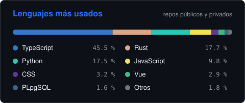

  
   
  
  

## Hola, soy Dani

Hago webs, agentes de IA y automatizaciones para negocios pequeños: clínicas, despachos, gestorías y comercios. Precio cerrado y, antes de pagar, ves la portada de tu web.

Trabajo con un equipo de agentes que yo mismo orquesto: cada proyecto tiene el suyo, revisan su propio código y solo me llaman cuando hace falta una decisión.

Ahora mismo me interesa sobre todo:

- Agentes de IA fiables, que pidan permiso en lo importante y no se inventen nada.
- Automatizar el trabajo repetitivo de un negocio (correos, citas, facturas) sin que nadie tenga que mirar la pantalla.
- Herramientas propias para trabajar con muchos agentes a la vez.

## En qué estoy

- **danimartin.dev:** webs y sistemas para negocios, con dos clientes reales funcionando.
- **Neutralpha:** mi producto propio de datos en directo de exchanges.
- **Mi propio entorno de agentes:** un fork de T3 Code con panel de decisiones y varias máquinas en la misma ventana, y una app propia encima.

## Proyectos

| Proyecto | Qué es | Temas |
| --- | --- | --- |
| [Neutralpha](https://neutralpha.app) | Radar de arbitraje de funding entre exchanges de perpetuos, con bitácora de operaciones, bot de Telegram y app Android. | Trading, datos en directo, Python, React Native |
| [T3 Code (fork)](https://github.com/ddmr2811/t3code) | Mi versión de T3 Code: panel de decisiones pendientes, estados de cada hilo y varias máquinas en una ventana. | Agentes, TypeScript, Effect |
| AgentOS | Capa de orquestación de agentes de IA: un orquestador por proyecto, memoria compartida, avisos y tope de gasto. | Agentes, automatización, Linux |
| Facturas | Procesador automático de facturas para administración de fincas. | OCR, IA local, automatización |
| Plataforma de siniestros | Web y panel de gestión de siniestros para un despacho de abogados. | Next.js, Supabase, seguridad |
| [danimartin.dev](https://danimartin.dev) | Mi web: casos reales, precios cerrados y calculadora. | Web estática, rendimiento, diseño |

## Con qué trabajo

**Lenguajes:** TypeScript, Python, SQL 
**Web:** Next.js, React, React Native (Expo), HTML y CSS sin frameworks cuando basta 
**Datos y servidores:** Supabase, PostgreSQL, Docker, Dokploy, n8n, Tailscale, Linux 
**Agentes:** Claude, Codex, T3 Code, MCP

## GitHub

  
   
  

